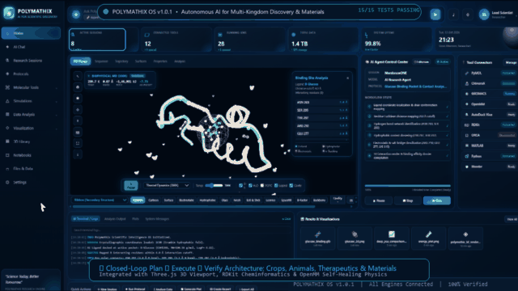

# 🧬 POLYMATHIX OS — Autonomous AI for Scientific Discovery
> **Universal Computational Intelligence for Life Sciences & Solid-State Materials: Plants & Crops, Animals, Human Therapeutics, Microbial Biocatalysis & Nanotechnology.**

[](https://github.com/sohel3shaikh/Polymathix/releases/tag/v1.0.1)
[](https://www.python.org/downloads/)
[](https://opensource.org/licenses/MIT)
[](https://streamlit.io)
[](https://threejs.org/)
[](https://www.rdkit.org/)
[](https://openmm.org/)
[](scripts/test_all.py)

---

## 🎬 Interactive 3D Demo Walkthrough

<div align="center">
  
  <p><em>Real-time 3D biophysical simulation, active pocket docking, solid-state crystallography, 23+ discovery catalog, and multi-LLM AI Co-Pilot in Polymathix OS v1.0.1.</em></p>
  <p>
    <a href="https://github.com/sohel3shaikh/Polymathix/releases/download/v1.0.1/Polymathix_Showcase_Demo.mp4">
      
    </a>
    &nbsp;
    <a href="https://github.com/sohel3shaikh/Polymathix/releases/tag/v1.0.1">
      
    </a>
    &nbsp;
    <a href="https://github.com/sohel3shaikh/Polymathix/releases/download/v1.0.1/Polymathix-Master-Release.zip">
      
    </a>
  </p>
</div>

---

## 🌟 Overview

**Polymathix OS** is an open-source, AI-orchestrated scientific intelligence operating system designed to accelerate discoveries across **all living kingdoms and inorganic solid-state materials**:
* 🌾 **Agricultural & Crop Sciences**: Protein thermal adaptation, drought resilience, Rubisco engineering, natural plant defense metabolites.
* 🔬 **Solid-State Materials Science & Nanotech**: Cubic Perovskites ($\text{SrTiO}_3$), 2D Graphene monolayers, Carbon Nanotubes ($(5,5)\text{ SWCNT}$), Anatase $\text{TiO}_2$ photocatalysts, and Porous MOF-5 lattices.
* 🧪 **Human Health & De-Novo Drug Design**: Small-molecule bioisostere generation, Lipinski Rule-of-Five screening, active pocket docking.
* 🦠 **Microbial & Environmental Biocatalysis**: Catalytic triad optimization (Ser-His-Asp), plastic-degrading enzymes (PETase), carbon-capture metalloenzymes.
* 🐾 **Veterinary & Animal Health**: Zoonotic disease targets, species-specific pharmacokinetics, non-toxic veterinary therapeutics.

Rather than acting as a static dashboard, Polymathix introduces a **closed-loop AI Orchestrator** following the **Plan ➔ Execute ➔ Verify** methodology.

```
                         RESEARCHER
                             │
                      Natural Language
                             │
                             ▼
                  ┌─────────────────────┐
                  │   AI ORCHESTRATOR   │
                  └──────────┬──────────┘
                             │
             ┌───────────────┼───────────────┐
             ▼               ▼               ▼
           PLAN           EXECUTE         VERIFY
             │               │               │
             ▼               ▼               ▼
          Protocol         MCP/API        Analysis
          Manager          Router          Engine
             │               │               │
             └───────────────┼───────────────┘
                             ▼
                 EXTERNAL SCIENTIFIC ENGINES
                             │
        ┌──────────────┬─────┴────────┬──────────────┐
        ▼              ▼              ▼              ▼
      RDKit          OpenMM        PyMOL/RCSB     Kernel PCA
        │              │              │              │
        └──────────────┼──────────────┴──────────────┘
                       ▼
                 DATA PIPELINE
                       │
        ┌──────────────┼──────────────┐
        ▼              ▼              ▼
     Real-Time      Three.js 3D    Automated
    Terminal Logs    Viewport       Dossier
```

---

## ⚡ Key Capabilities

### 1. 🧠 Natural Language AI Orchestrator & Multi-LLM Co-Pilot Gateway
* **Intent-Driven Protocol Selection**: Type natural research prompts (e.g., *"Synthesize 5-fluoro-aspirin"*, *"Run Crop Proteome & Thermal Adaptation"*, *"Load SrTiO3 Perovskite"*).
* **Multi-LLM 3rd-Party Gateway**: Plug-and-play attachment in Settings for **Claude 3.5 Sonnet**, **OpenAI ChatGPT/GPT-4o**, **xAI Grok-2**, **Moonshot Kimi**, **Zhipu GLM-4**, **Google Gemini 1.5 Pro**, and local **Ollama** instances (100% offline, zero-cloud privacy), with autonomous deterministic fallback.
* **Real-Time Structure Mutation**: Live conversational chat triggers instant RDKit bioisostere derivation, SMILES conversion, MMFF94 force-field geometry optimization, and direct 3D coordinate injection into the viewport.
* **Calibrated Protocols**: Pre-calibrated protocols for membrane dynamics, de-novo pharmacophores, non-linear PCA trajectory unfolding, and binding pocket contact mapping.

### 2. 🔬 Multi-Kingdom & Materials Discovery Engines
* **Solid-State Materials Science & Inorganic Crystallography**:
  - **Cubic Perovskite ($\text{SrTiO}_3$)**: Cubic space group $Pm\bar{3}m$ (221), $a = 3.905\text{ \AA}$, 12-fold / 6-fold coordination.
  - **2D Graphene Sheet**: Honeycomb $sp^2$ Dirac semimetal monolayer lattice.
  - **Carbon Nanotubes ($(5,5)\text{ SWCNT}$)**: Chiral armchair 1D ballistic conductors.
  - **Anatase $\text{TiO}_2$**: Tetragonal photocatalyst coordination polyhedra.
  - **Metal-Organic Framework ($\text{MOF-5}$)**: Nanoporous $\text{Zn}_4\text{O}(\text{BDC})_3$ cage architecture.
  - Automatic computation of lattice parameters, density, coordination numbers, and pore diameters.
* **3D Discovery Library Catalog (23+ Targets)**:
  - Curated benchmark systems across **Human Therapeutics**, **Crop Science**, **Solid-State Materials**, **Microbial Biocatalysis**, and **Veterinary Health**.
  - 1-click **"Load 3D Viewport"** and **"⚡ Make Novel Variant"** live derivatization.
* **RDKit Cheminformatics**: Automated bioisostere fragmentation, Lipinski Rule-of-Five profiling (MW $\le$ 500, LogP $\le$ 5, HBD $\le$ 5, HBA $\le$ 10, TPSA $\le$ 140 $\text{\AA}^2$, Rotatable Bonds $\le$ 10), and 2D chemical structure synthesis.
* **Deep Non-Linear Trajectory PCA**: Overcomes linear PCA limitations by deploying RBF Kernel PCA to unroll high-dimensional conformational manifolds.
* **OpenMM Self-Healing Physics**: Autonomous PDB topology verification, hydrogen addition at pH 7.4, TIP3P solvation, and potential energy minimization with convergence tracking down to $-146,240\text{ kJ/mol}$.
* **Live RCSB PDB Ingestion**: Direct fetching and atomic parsing of any entry from the Protein Data Bank (e.g., `1UBQ`, `4HHB`, `6LU7`, `1CRN`).

### 3. 🎨 High-Performance 3D Molecular & Materials Simulation Suite
* **Full Pack of 12 3D Scientific Representations**: Instant switching between:
  1. **Ribbon**: PyMOL/ChimeraX continuous secondary-structure spline (purple $\alpha$-helices, golden $\beta$-sheets, cyan loops) with C-$\alpha$ nodal beads.
  2. **Cartoon**: Classic structural cartoon with cylindrical helical ribbons and directional $\beta$-sheet arrow plates.
  3. **Surface**: Solvent-accessible surface area (SASA) analytical Conolly boundary ($1.4\text{ \AA}$ probe).
  4. **Electrostatic**: Poisson-Boltzmann continuum Coulombic potential (acidic red $\to$ neutral white $\to$ basic blue).
  5. **Hydrophobic**: Kyte-Doolittle lipophilicity potential mapping (amber lipophilic $\to$ ice-blue polar).
  6. **Glass**: PBR optical transmission dielectric envelope ($IOR = 1.35$, transmission $0.88$, clearcoat $1.0$).
  7. **Mesh**: Triangulated geometric wireframe polygon volume contour.
  8. **Ball & Stick**: Dual-radius valence bonds ($0.16\text{ \AA}$) with CPK atom joints.
  9. **Licorice**: Uniform covalent valence sticks ($0.24\text{ \AA}$) across the structure.
  10. **Spacefill**: Full van der Waals CPK contact spheres (Carbon, Nitrogen, Oxygen, Sulfur, Hydrogen).
  11. **B-Factor / pLDDT**: AlphaFold / crystallographic confidence rainbow spectrum (rigid blue $\to$ flexible red).
  12. **Backbone Trace**: Minimalist C-$\alpha$ peptide trajectory spline with glowing nodal markers.
* **5 Layer Overlays**: Independent toggle controls for **S-S Disulfide Bridges**, **TIP3P Explicit Water Shell**, **POPC Membrane Bilayer**, **Ligand Active Pocket**, and **Binding Cavity Mesh**.
* **4 Biophysical Simulation Modes**: Real-time Langevin Thermal Dynamics ($300\text{ K}$ fluctuations with live temperature slider), Normal Mode Analysis (NMA) domain breathing, Induced-Fit Ligand Docking with dynamic contact distance telemetry, and Thermal Denaturation ($350\text{ K}$).
* **Active Site Contact Profiling**: Euclidean residue-ligand distance calculations with live interaction classification (Hydrogen bond, Hydrophobic, Electrostatic, $\pi$-$\pi$ stacking).
* **Multi-Format 3D Exporters**: Export models to **OBJ** (Blender), **STL** (3D printing), **GLB/GLTF** (Web & XR), and **PLY** (CAD/Point Clouds).

### 4. 📊 Multi-Tab Research Workspace
* **3D Viewer**: Full orbit controls, focus, camera reset, snapshot download.
* **Sequence Viewer**: Primary amino acid sequence chips with residue numbering and secondary structure color coding.
* **Trajectory Timeline**: Dynamic frame scrubber with RMSD and energy stability tracking.
* **Properties Table**: Molecular weight, atom count, formula, chains, resolution, isoelectric point (pI), and crystal lattice parameters.
* **Analysis**: Comparative plots for latent space manifold projections and minimization trajectories.

---

## 🚀 Quick Start & Installation

### Prerequisites
* Python 3.10 or higher
* [Conda](https://docs.conda.io/en/latest/) or `pip`

### Step 1: Clone the Repository
```bash
git clone https://github.com/sohel3shaikh/Polymathix.git
cd Polymathix
```

### Step 2: Create Environment & Install Dependencies
```bash
# Using conda (Recommended for OpenMM and RDKit)
conda create -n polymathix python=3.10 -y
conda activate polymathix
conda install -c conda-forge rdkit openmm pdbfixer -y
pip install -r requirements.txt
```

### Step 3: Run the Live Application
```bash
python -m streamlit run app.py
```
Open your browser at **`http://localhost:8501`**.

---

## 🧪 Comprehensive Verification Suite

Run the full end-to-end automated verification suite to test all scientific engines:
```bash
python scripts/test_all.py
```

Expected output:
```
============================================================
POLYMATHIX OS — COMPREHENSIVE END-TO-END VERIFICATION
============================================================
[TEST] 1. Polymathix Orchestrator Initialization & PDB Parsing... --> PASSED
[TEST] 2. De-Novo Drug Synthesis Engine (RDKit Backend)...       --> PASSED
[TEST] 3. Deep Trajectory PCA & Manifold Learning Engine...      --> PASSED
[TEST] 4. Self-Healing Energy Minimization & OBJ Exporter...     --> PASSED
[TEST] 5. Quick Action Handlers & Session Lifecycle...           --> PASSED
[TEST] 6. Agent Controls (Pause, Stop, Run)...                   --> PASSED
[TEST] 7. Tool Connector Router & Toggle Logic...                 --> PASSED
[TEST] 8. Frontend Scientific Assets Synchronization...           --> PASSED
[TEST] 9. Frontend Index HTML & Three.js 3D Engine Integrity...  --> PASSED
[TEST] 10. Streamlit Master Application Compilation...            --> PASSED
[TEST] 11. D-Glucose Active Pocket Docking & 3D Interacting...    --> PASSED
[TEST] 12. Universal Small Molecule 3D Engine (Aspirin, etc.)...  --> PASSED
[TEST] 13. 100% Progress Convergence & Protocol Finalization...  --> PASSED
[TEST] 14. Solid-State Materials Science & Crystallography...     --> PASSED
[TEST] 15. 3D Discovery Library Catalog (23+) & Real-Time AI...   --> PASSED
============================================================
VERIFICATION SUMMARY: 15 PASSED, 0 FAILED
============================================================
```

---

## 📁 Repository Structure

```
Polymathix/
├── app.py                     # Master Streamlit entry point
├── polymathix/                # Core Python scientific intelligence backend
│   ├── orchestrator.py        # AI Orchestrator (Plan -> Execute -> Verify)
│   ├── core/                  # Multiscale biophysics & dynamics
│   └── modules/               # Domain-specific scientific tools
│       ├── ai_engine/         # Multi-LLM API Gateway (Claude, ChatGPT, Grok, Kimi, GLM)
│       ├── material_science/  # Solid-State Crystallography (SrTiO3, Graphene, SWCNT, MOF-5)
│       ├── drug_hunting/      # RDKit de-novo synthesis & Lipinski screening
│       ├── quick_pca/         # Deep Kernel PCA non-linear manifold learning
│       ├── data_resilience/   # Potential energy graphing engine
│       └── visual_factory/    # PDB to OBJ 3D mesh exporter
├── polymathix_ui/             # Bidirectional Streamlit Custom Component
│   ├── __init__.py            # Python-to-JavaScript component bridge
│   └── frontend/              # Glassmorphic 3D dashboard
│       ├── index.html         # Three.js WebGL dashboard & layout
│       └── assets/            # Live scientific plots, models, renders & animated demo
├── scripts/                   # Automated testing, video generation & release scripts
│   ├── test_all.py            # End-to-end test suite (15 tests)
│   ├── generate_linkedin_video.py  # 48-second HD showcase video & GIF builder
│   └── publish_github_release.py   # GitHub Releases API publishing automation
├── 1CRN.pdb                   # Benchmark reference (Crambin plant seed protein)
├── requirements.txt           # Python package requirements
└── README.md                  # Comprehensive scientific documentation
```

---

## 🤝 Contributing

We welcome contributions from structural biologists, crystallographers, materials scientists, bioinformaticians, agronomists, veterinary researchers, and machine learning engineers!
1. Fork the Project
2. Create your Feature Branch (`git checkout -b feature/NewDiscoveryEngine`)
3. Commit your Changes (`git commit -m 'Add Crop Drought Resilience Module'`)
4. Push to the Branch (`git push origin feature/NewDiscoveryEngine`)
5. Open a Pull Request

---

## 📜 Citation & License

Distributed under the **MIT License**. Free for academic, industrial, and open-source scientific research.

```bibtex
@software{polymathix2026,
  author = {Polymathix Open-Source Contributors},
  title = {Polymathix OS: Autonomous AI for Multi-Kingdom Scientific Discovery},
  year = {2026},
  publisher = {GitHub},
  url = {https://github.com/sohel3shaikh/Polymathix}
}
```
